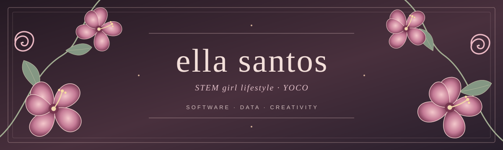

  

   
  <em>Carpe Diem. · You only commit once.</em>
    
  <strong>software development · data · languages · a little chaos</strong>

 

### 01. the girl behind the code

Hi, I'm **Rafaella** — a Brazilian high school student studying software development, drawn to **backend engineering**, **data**, and **business intelligence**.

I love understanding how things work, asking too many questions, and building something out of the answers.

> *Somewhere between logic and poetry, you'll find me.*

- Currently exploring **Java, Python, SQL, HTML & CSS** and modern data workflows.
- Interested in **data engineering, BI, automation, and software architecture**.
- Outside the terminal: **books, rock & MPB, cinema, video games, and languages**.

---

### 02. my digital greenhouse

  

 

**Also exploring:** Snowflake · dbt · Jinja · VBA · SQL Server · Git workflows

<strong>✿ open the greenhouse — what I'm growing</strong>

 

| Branch | What I'm exploring |
| :--- | :--- |
| **Backend** | Java, Jakarta Servlets, JDBC, PostgreSQL |
| **Data & BI** | SQL, Snowflake, dbt, validation and transformations |
| **Web** | HTML, CSS and application flows |
| **Automation** | Python, scripting and practical workflows |

---

### 03. pages from the garden

<strong>✿ chapter i — projects & experiments</strong>

 

**[studying](https://github.com/ellasantoss/studying)** — my public space for experimenting with dbt and data workflows.

More projects will bloom here as they're ready to share.

<strong>✿ chapter ii — beyond the terminal</strong>

 

I'm interested in the intersection of **technology, storytelling, and communication**. I enjoy books, music, films, gaming, and learning languages — because curiosity doesn't fit into just one discipline.

*Oie! Sou a Rafaella, brasileira, estudante de desenvolvimento de sistemas e apaixonada por comunicação. Meu perfil vai além das linguagens de programação: também adoro idiomas e descobrir outras formas de ver o mundo.*

<strong>✿ chapter iii — a note to visitors</strong>

 

Thanks for wandering into my little corner of GitHub. This is a work in progress, just like every good garden.

---

### 04. growth, in commits

  
   
  

 

  ✿ rooted in curiosity · growing through code ✿

